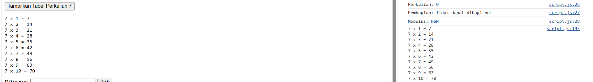
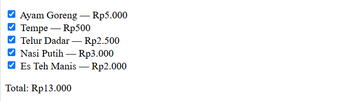
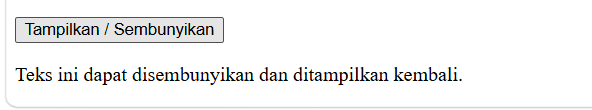

# LAPORAN PRAKTIKUM 5: JAVASCRIPT DASAR DAN MANIPULASI HTML

**Mata Kuliah:** Pemrograman Web — Pertemuan 6 (Praktikum 5)  
**Repository:** [Lab5Web](https://github.com/username/Lab5Web)

## Identitas Mahasiswa
- **Nama:** Yusuf Hamdani
- **NIM:** 312510049
- **Program Studi:** Teknik Informatika
- **Mata Kuliah:** Pemrograman Web

---

## 1. Tujuan Praktikum
1. Memahami sintaks dasar JavaScript dan cara menyisipkan JavaScript pada HTML.
2. Menggunakan variabel, tipe data, operator, percabangan, perulangan, dan function.
3. Menampilkan informasi melalui Console, `alert()`, `prompt()`, dan elemen HTML.
4. Memanipulasi konten serta gaya elemen HTML menggunakan JavaScript.
5. Membuat interaksi sederhana pada form dan melakukan validasi input.
6. Mendokumentasikan pekerjaan praktikum beserta hasil pengujiannya.

---

## 2. Alat yang Digunakan
- Visual Studio Code
- Web Browser modern (dengan DevTools / Console)
- Git & GitHub

---

## 3. Struktur Repository
```text
Lab5Web/
├── index.html
├── script.js
├── Screenshot/
│   ├── ss1.png
│   ├── ss2.png
│   ├── ss3.png
│   ├── ss4.png
│   ├── ss5.png
│   ├── ss6.png
│   ├── ss7.png
│   ├── ss8.png
│   ├── ss9.png
│   ├── ss10.png
│   ├── ss11.png
│   ├── ss12.png
│   ├── ss13.png
│   ├── ss14.png
│   ├── ss15.png
│   └── ss16.png
└── README.md
```

---

## 4. Hasil Praktikum & Pengujian

### 4.1 Latihan 1 — Menampilkan Output
Mengubah konten elemen `<p id="pesan">` menggunakan `textContent` dan mencetak output ke `console.log()`.
- **Hasil:** Teks pada halaman berubah menjadi "Hello World" dan pesan muncul di Console.


---

### 4.2 Latihan 2 — Alert dan Prompt
Meminta masukan nama melalui `prompt()` dan menampilkan sapaan dengan `alert()`.
- **Hasil:** Menampilkan pesan selamat datang di halaman jika terisi, atau alert peringatan jika kosong/batal.


---

### 4.3 Latihan 3 — Function dan Operasi Aritmetika
Membuat fungsi `operasiDasar(a, b)` yang melakukan operasi penjumlahan, pengurangan, perkalian, pembagian, dan modulus.
- **Hasil:** Hasil kalkulasi dicetak langsung di Console browser.


---

### 4.4 Latihan 4 — Seleksi Kondisi if–else
Memeriksa input nilai dari `prompt()` dan menentukan status kelulusan (nilai minimal 60).
- **Hasil:** Menampilkan alert "Lulus", "Belum lulus", atau "Input nilai tidak valid".


---

### 4.5 Latihan 5 — Seleksi Kondisi switch
Meminta input angka 1–5 dari `prompt()` dan menampilkan nama bilangannya menggunakan `switch`.
- **Hasil:** Alert menampilkan terjemahan angka ("Bilangan satu", dsb.) atau "Pilihan tidak tersedia".


---

### 4.6 Latihan 6 — Form Bilangan Genap atau Ganjil
Memeriksa nilai dari input form untuk menentukan apakah termasuk bilangan genap atau ganjil.
- **Hasil:** Teks pesan dinamis ditampilkan langsung di halaman HTML.


---

### 4.7 Latihan 7 — Mengubah Warna Halaman
Mengubah warna latar belakang halaman (`document.body.style.backgroundColor`) menggunakan tombol interaktif.
- **Hasil:** Warna latar berubah sesuai tombol yang diklik (`lightgreen`, `white`, `lightyellow`).


---

### 4.8 Latihan 8 — DOM dan Checkbox Menu Makanan
Menghitung total harga makanan secara otomatis berdasarkan checkbox yang dicentang menggunakan *event listener*.
- **Hasil:** Total harga diperbarui secara real-time dengan format mata uang rupiah.


---

## 5. Mini Project — Kalkulator Nilai Mahasiswa
Aplikasi kalkulator nilai mahasiswa yang menerima komponen Nilai Tugas (30%), UTS (30%), dan UAS (40%). Program menghitung nilai akhir, menentukan predikat huruf (A-E), status kelulusan, dan memvalidasi rentang input (0–100).


---

## 6. Eksperimen Mandiri

### 6.1 Eksperimen 1 — Latihan 3 dengan Masukan dari Prompt
Menerima dua input bilangan melalui `prompt()` lalu memprosesnya pada fungsi `operasiDasar()`.


### 6.2 Eksperimen 2 — Tabel Perkalian 7
Menggunakan perulangan `for` untuk mencetak tabel perkalian angka 7 (1 sampai 10) ke elemen `<pre>`.


### 6.3 Eksperimen 3 — Function cekGenap(angka)
Fungsi yang mengembalikan nilai boolean (`true`/`false`) untuk menguji sifat genap suatu bilangan.


### 6.4 Eksperimen 4 — Validasi Form Kolom Tidak Boleh Kosong
Validasi form sederhana untuk memastikan kolom Nama dan Email tidak dikosongkan.


### 6.5 Eksperimen 5 — Menambah Pilihan Menu pada Latihan 8
Pengembangan Latihan 8 dengan menambah menu baru (Nasi Putih & Es Teh Manis).


### 6.6 Eksperimen 6 — Menyembunyikan dan Menampilkan Elemen
Fungsi *toggle* untuk merubah properti `style.display` elemen dari `none` ke `block` atau sebaliknya.


---

## 7. Tugas Pertanyaan Validasi
Script khusus untuk memvalidasi input Nama (tidak boleh kosong) dan Nilai (harus berupa angka 0–100).


---

## 8. Kesimpulan
Melalui praktikum ini, telah dipelajari sintaks dasar JavaScript meliputi variabel (`let` dan `const`), fungsi, percabangan, perulangan, serta manipulasi DOM. Pemisahan logika program dengan tampilan antarmuka dan penanganan validasi input sangat penting untuk membangun aplikasi berbasis web yang interaktif dan responsif.